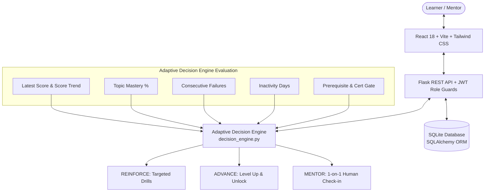

# AdaptIQ — AI-Powered Adaptive Learning Coach

> **Hackathon Problem #8 Reference Implementation**  
> *"Every learner is different. Every learning path should be too."*

AdaptIQ is an end-to-end adaptive educational coaching platform designed to prevent student drop-off in online education. By continuously evaluating real-time quiz performance, historical score trajectories, topic-level mastery, prerequisite verification, and inactivity signals, AdaptIQ autonomously determines whether a learner should **REINFORCE** foundational concepts, **ADVANCE** to higher levels, or connect with a **MENTOR** for personalized human intervention.

---

## 1. Problem Statement

Online learning platforms experience massive dropout rates when instructional content is either too difficult or too easy:
- Learners who encounter difficulty without targeted remediation become discouraged and abandon courses.
- Fast learners who are forced to repeat mastered material lose motivation.
- Struggling or disengaged students often remain unnoticed until it is too late for human educators to intervene.

**AdaptIQ solves this problem** by providing:
1. Real-time diagnostic skill assessments across core topics.
2. A transparent, explainable multi-factor adaptive decision engine.
3. Automated learning-path triage: `REINFORCE`, `ADVANCE`, or `MENTOR`.
4. Prerequisite and certification gating before advancement.
5. A live Mentor Hub with cohort analytics, risk detection, and intervention logging.

---

## 2. System Architecture



---

## 3. Technology Stack

| Layer | Technologies |
|---|---|
| **Frontend** | React 18, Vite, Tailwind CSS, Lucide Icons, Recharts |
| **Backend** | Python 3.10+, Flask REST API, Flask-CORS, PyJWT, Werkzeug |
| **Storage** | SQLite3, SQLAlchemy ORM |
| **Decision AI** | Python-based multi-factor explainable rule policy engine |
| **Testing** | pytest (API integration tests & Decision engine unit tests) |

*Zero paid APIs or external network dependencies are required at runtime.*

---

## 4. Adaptive Decision Logic & Safeguards

The decision engine in [`decision_engine/decision_engine.py`](file:///Users/rosssssss/Downloads/Adaptive-learning-coach-main/decision_engine/decision_engine.py) implements transparent, explainable policies:

### Decision Rules:
1. **MENTOR (High Priority Intervention)**
   - **Trigger 1**: Persistent failure ($\ge 2$ failed attempts with score $< 60\%$, or $\ge 3$ cumulative failures).
   - **Trigger 2**: Prolonged inactivity ($\ge 14$ days inactive) combined with low mastery or prior struggles.
   - **Trigger 3**: Critical downward score trajectory with repeated conceptual stumbling.
   - *Safeguard*: A single low quiz score on an initial attempt does **not** trigger mentor intervention; it triggers targeted reinforcement.

2. **ADVANCE (Level Progression)**
   - **Trigger**: Latest assessment score $\ge 80\%$, estimated mastery $\ge 75\%$, **AND** all mandatory prerequisites and certifications are verified completed.
   - *Safeguard*: High quiz scores **never** bypass mandatory prerequisites. If prerequisites or certification requirements are unmet, advancement is blocked and gated to `REINFORCE`.

3. **REINFORCE (Targeted Practice)**
   - **Trigger**: Assessment scores $< 80\%$ or topic mastery $< 75\%$ not meeting mentor intervention thresholds.
   - Analyzes fine-grained topic mastery (e.g., Variables, Loops, Functions, Dictionaries) to prescribe exact revision drills (e.g., *"Revise Loops: Complete targeted practice drills before retaking"*).

---

## 5. Database Schema

The persistent SQLite schema maintains relational integrity across sessions:

- `users`: ID, name, email, password hash, role (`student` or `mentor`), created date.
- `learners`: ID, user ID (1-to-1), student code (`STU-2024-XXX`), course track, level, lessons completed/total, last activity, prerequisite status, certification status, streak.
- `questions`: ID, topic, question text, 4 options (JSON), correct answer, difficulty, educational explanation.
- `quiz_attempts`: ID, learner ID, timestamp, percentage score, raw score, total questions, topic breakdown (JSON), answer details.
- `learning_decisions`: ID, learner ID, attempt ID, timestamp, action (`REINFORCE`, `ADVANCE`, `MENTOR`), reasons list (JSON), next activity, priority, mastery %, unmet requirements (JSON).
- `mentor_interventions`: ID, learner ID, mentor ID, timestamp, note text, status (`pending`, `completed`), action type, outcome.

---

## 6. Demo Accounts & Test Bench

The database is pre-seeded with 10 diverse student personas and 2 mentor accounts:

| Role | Name | Email | Password | Scenario Profile |
|---|---|---|---|---|
| **Student** | Alex Rivera | `student1@demo.com` | `password123` | Active learner (~75% score, Level 1) |
| **Student** | Maya Lin | `student2@demo.com` | `password123` | **Scenario B**: Ready to Advance (95% score, Level 2) |
| **Student** | Jordan Hayes | `student3@demo.com` | `password123` | **Scenario D**: High score (88%) but Missing Prerequisite |
| **Student** | Carlos Gomez | `student4@demo.com` | `password123` | **Scenario C**: Repeated failures (45%), Needs Mentor |
| **Student** | Priya Sharma | `student5@demo.com` | `password123` | Inactive learner (21 days inactive), Flagged for outreach |
| **Student** | Liam Chen | `student6@demo.com` | `password123` | **Scenario A**: Needs Reinforce (62% score on Loops) |
| **Student** | Emma Watson | `student7@demo.com` | `password123` | **Scenario E**: Brand new student (0 quiz attempts, clean state) |
| **Mentor** | Dr. Evelyn Vance | `mentor@demo.com` | `password123` | Senior Learning Coach (Full cohort access) |
| **Mentor** | Prof. Alan Turing | `coach2@demo.com` | `password123` | Track Lead (Full cohort access) |

---

## 7. Installation & Quick Start

### Prerequisites
- Python 3.10+
- Node.js 18+ and npm

### 1. Setup Backend
```bash
# Create virtual environment
python3 -m venv backend/venv
source backend/venv/bin/activate

# Install dependencies
pip install -r backend/requirements.txt

# Initialize & seed SQLite database with demo data
PYTHONPATH=. python backend/app.py seed
```

### 2. Setup Frontend
```bash
cd frontend
npm install
```

### 3. Run the Application

#### Option A: One-command startup script
From the root directory:
```bash
./start.sh
```

#### Option B: Run in separate terminals
**Terminal 1 (Backend API):**
```bash
source backend/venv/bin/activate
PYTHONPATH=. python backend/app.py
# Backend runs at http://127.0.0.1:5001
```

**Terminal 2 (Frontend App):**
```bash
cd frontend
npm run dev
# Frontend runs at http://localhost:5173
```

Open your browser to: **[http://localhost:5173](http://localhost:5173)**

---

## 8. API Endpoints

All protected endpoints require `Authorization: Bearer <token>`. Role enforcement is checked on the backend:

| Method | Endpoint | Access | Description |
|---|---|---|---|
| `GET` | `/api/health` | Public | Service health check |
| `POST` | `/api/auth/login` | Public | Authenticate user and issue JWT |
| `GET` | `/api/auth/me` | Authenticated | Get current user profile and role |
| `POST` | `/api/auth/logout` | Authenticated | Session logout |
| `GET` | `/api/auth/demo-accounts` | Public | List available demo accounts |
| `GET` | `/api/student/dashboard` | Student | Student dashboard metrics and recent scores |
| `GET` | `/api/student/history` | Student | Complete student assessment history |
| `GET` | `/api/quiz/questions` | Student | 5 quiz questions (answers stripped) |
| `POST` | `/api/quiz/submit` | Student | Submit answers, calculate score, evaluate decision |
| `GET` | `/api/mentor/overview` | Mentor | Live cohort summary metrics |
| `GET` | `/api/mentor/students` | Mentor | Searchable, filterable student directory |
| `GET` | `/api/mentor/students/<id>` | Mentor | Detailed student profile, history, and AI factors |
| `POST` | `/api/mentor/students/<id>/review`| Mentor | Mark student record as reviewed |
| `POST` | `/api/mentor/interventions` | Mentor | Record mentor check-in note and outcome |
| `GET` | `/api/mentor/follow-ups` | Mentor | List all cohort follow-up actions |

---

## 9. Automated Testing & Verification

AdaptIQ includes comprehensive unit and integration test suites:
- **Decision Engine Tests** (`tests/test_decision_engine.py`): verifies threshold math, score trends, and policy logic.
- **API Tests** (`tests/test_api.py`): verifies auth, role barriers, quiz evaluation, and answers privacy.
- **Scenario Tests** (`tests/test_scenarios.py`): tests Hackathon Scenarios A through H.

Run the test suite:
```bash
PYTHONPATH=. ./backend/venv/bin/pytest tests/
```

**Result: 22 passed, 0 failed.**

---

## 10. Known Limitations & Hackathon Considerations
- The initial question pool contains 10 Python questions; expanding the curriculum across multiple languages is planned for future releases.
- The decision engine uses a transparent, explainable deterministic policy rather than a black-box deep learning model, ensuring evaluators can audit every recommendation without hallucination risk.
